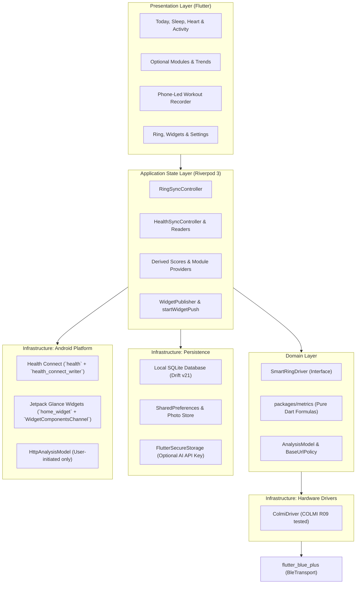
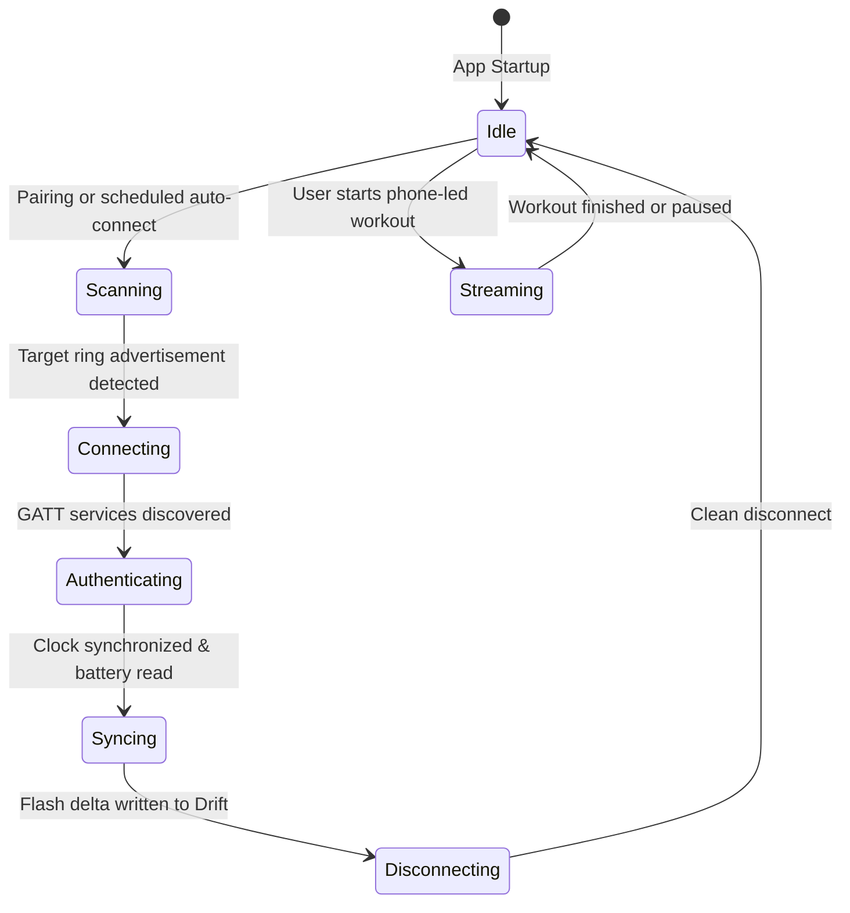

# OpenRing Client Architecture

Architectural overview for the OpenRing Flutter companion client (Android first; iOS is deferred per [`plan.md`](plan.md)).

## 1. System Context & Layering

> [!NOTE] Hybrid Ingestion Model
> OpenRing combines direct BLE sync for the smart ring with opt-in Android Health Connect reads:
> 1. **Direct BLE Driver**: `ColmiDriver` over `BleTransport` (`SmartRingDriver` interface in `packages/ring_driver`) handles flash history backfill and live workout HR without holding an all-day connection.
> 2. **Health Platform Bridge**: Writes ring metrics and GPS workouts idempotently to Android Health Connect (`health` plugin + `packages/health_connect_writer`), and optionally reads sleep sessions and workouts recorded by other apps with per-type source priority.

---

## 2. Bluetooth Lifecycle & State Machine

Managing Bluetooth Low Energy connections with wearables uses short connect-sync-disconnect cycles rather than a permanent link:

### Key Strategies:
1. **Connect, sync, disconnect**: The app holds no permanent link and runs no reconnect loop. Each sync (app foreground, pull to refresh, or the WorkManager periodic job) connects, pulls delta history since the last cursor, writes to Drift in one transaction, and disconnects. Only an active workout keeps the link open for live heart rate, and pausing stops the live stream.
2. **Android Foreground Services**: `RingSyncForegroundService` (type `connectedDevice`, low-importance notification) runs while a background sync talks to the ring; `WorkoutForegroundService` (with `geolocator`'s foreground `location` service for outdoor routes) keeps live HR and route tracking active during a workout.
3. **iOS Background Modes**: Deferred until a Mac is available for iOS builds and testing.

---

## 3. Data Flow & Synchronization Pipeline

1. **Scheduled & Foreground Sync**:
   * The phone connects to the paired COLMI R09 (`ColmiDriver` over `packages/ring_driver` and `packages/ring_protocol`, see [`protocols/realsil-colmi.md`](protocols/realsil-colmi.md)).
   * Delta history (sleep segments, heart rate, HRV, SpO2, stress, and 15-minute activity buckets) is pulled since the stored `sync_cursors` row and committed atomically to SQLite (Drift v21).
   * After commit, `ProcessHealthOutbox` processes pending Health Connect upserts (`health` + `packages/health_connect_writer`), and `WidgetPublisher` / `publishWidgetSnapshot` publishes the updated `WidgetSnapshot` v2 payload to the 5 Jetpack Glance widgets.
2. **Phone-Led Workout Flow**:
   * The user starts a workout on the phone (`WorkoutController`); the ring streams live heart rate and outdoor workouts attach GPS route points (`geolocator`).
   * On completion, the workout is saved to Drift, queued for Health Connect (`ExerciseSessionRecord`, heart rate series, and `ExerciseRoute`), and can be exported to GPX, CSV, or JSON.
3. **Optional Modular Features & AI Analysis**:
   * Eight modules (Body, Open Score, Energy, Effort, Goals, Food, AI Analysis, Trajectory) remain off by default in Settings > Modules.
   * When enabled, AI Analysis (`HttpAnalysisModel`) sends user-initiated summaries, Goals review text, or resized EXIF-stripped meal photos only to the endpoint configured by the user, storing any optional API key in Android `FlutterSecureStorage` outside SQLite, exports, and backups.

---

## 4. Technology Stack Selection

* **Framework**: Flutter 3.x (Dart `^3.13.5`).
* **BLE Engine**: `flutter_blue_plus` 2.x behind `BleTransport`.
* **State Management**: Riverpod 3 (`flutter_riverpod`).
* **Routing**: `go_router` with 11 ARB locales.
* **Local Persistence**: SQLite via `drift` and `drift_flutter` (schema v21; see [`plan.md`](plan.md), Storage) plus `flutter_secure_storage` for the optional AI API key.
* **Health Platforms**: Android Health Connect via `health` `13.3.2` and `packages/health_connect_writer` native Kotlin channels (`SleepSessionRecord`, hourly/workout `HeartRateRecord` series, opt-in `ExerciseSessionRecord` read); iOS HealthKit is deferred.
* **Widgets & Charts**: `home_widget` + Jetpack Glance (`Today`, `This week`, `Readiness`, `Ring`, `Start workout`) + `WidgetComponentsChannel`; custom Flutter `CustomPainter` implementations for hypnograms and trend charts.
