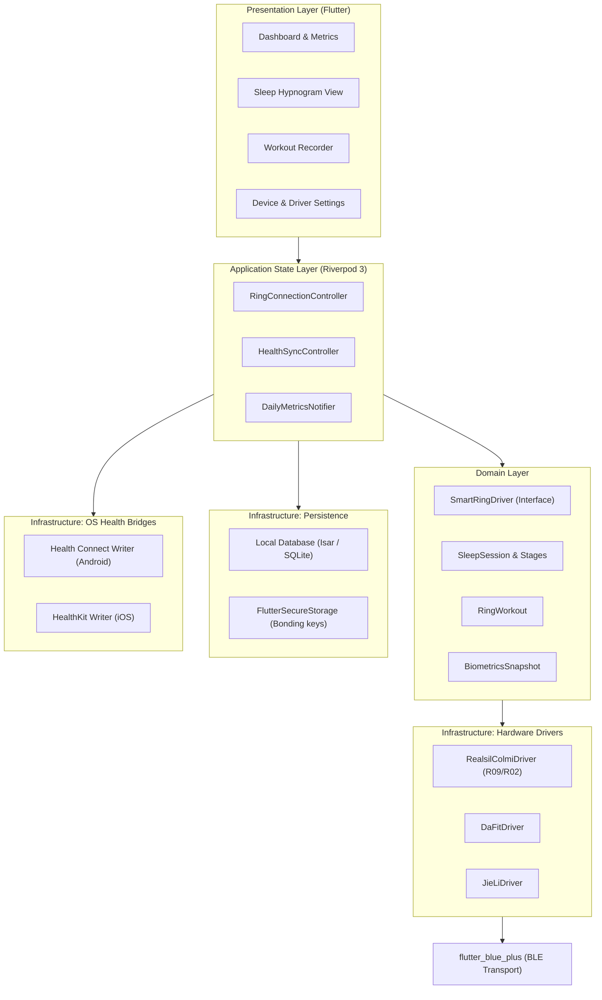
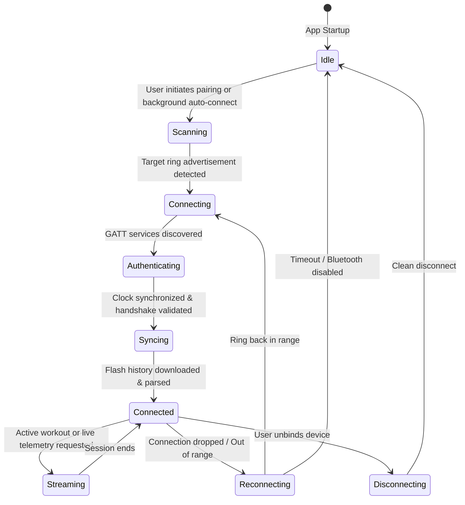

# OpenRing Client Architecture

Comprehensive architectural design for the Flutter cross-platform client (Android and iOS).

## 1. System Context & Layering

---

## 2. Bluetooth Lifecycle & State Machine

Managing Bluetooth Low Energy connections with wearables requires a resilient state machine to handle aggressive OS battery management:

### Key Strategies:
1. **Exponential Backoff Reconnection**: When the ring goes out of range (e.g. user leaves phone in another room), the app uses an exponential backoff schedule to preserve phone battery.
2. **Android Foreground Service**: A lightweight foreground service with a persistent low-priority notification ("OpenRing: Connected to COLMI Ring 2") ensures Android's LMK (Low Memory Killer) does not kill the BLE process.
3. **iOS Background Modes**: Leverages `bluetooth-central` background execution and `BGAppRefreshTask` to process morning sleep syncs automatically.

---

## 3. Data Flow & Synchronization Pipeline

1. **Morning Wakeup Sync**:
   * The phone reconnects to the ring.
   * `syncSleepHistory(today)` is dispatched.
   * The ring transmits packed flash memory buffers over GATT characteristic `0xFEA2`.
   * The driver unpacks bytes into `SleepSession` (Start, End, Wake, Light, Deep, REM intervals).
   * Telemetry is written to the local database.
   * Telemetry is immediately dispatched to **Health Connect** (`SleepSessionRecord`) and **Apple HealthKit** (`HKCategoryTypeIdentifierSleepAnalysis`).

2. **Workout Recording Flow**:
   * The user starts a workout in OpenRing (or triggers sport mode on the ring).
   * Live PPG sampling rate increases (continuous 1Hz heart rate stream).
   * OpenRing calculates active energy and splits.
   * On completion, OpenRing generates an official workout and syncs it to Health Connect/HealthKit.
   * **Kapi** (and any other fitness app on the device) instantly imports the workout as a verified wearable session!

---

## 4. Technology Stack Selection

* **Framework**: Flutter 3.x (Dart 3.x).
* **BLE Engine**: `flutter_blue_plus` (cross-platform, reliable MTU negotiation, stable GATT subscription).
* **State Management**: Riverpod 3 (`flutter_riverpod`).
* **Routing**: `go_router`.
* **Local Persistence**: `isar` or `sqlite3` via `drift` for fast time-series queries.
* **Health Platforms**:
  * Android: Custom native Kotlin MethodChannel implementing AndroidX Health Connect Client `1.2.0-alpha`.
  * iOS: Custom native Swift MethodChannel or `health` plugin for HealthKit.
* **Charts**: Custom Flutter painters or `fl_chart` for performant 60fps graphs.
