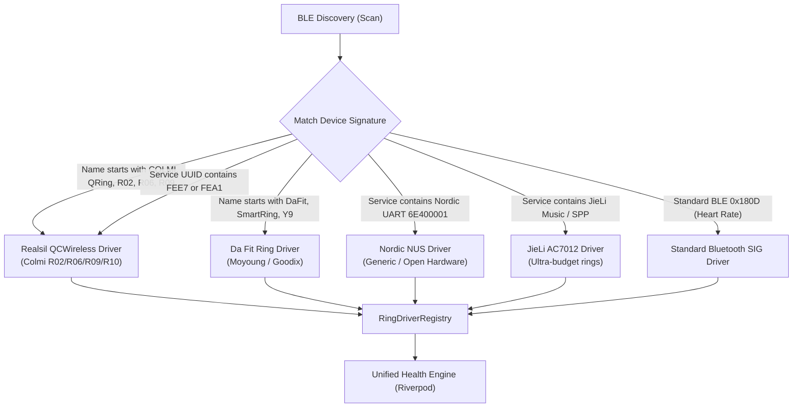

# Multi-Ring Driver Architecture

Design for universal smart ring support, decoupling the core application logic from manufacturer-specific BLE protocols.

## 1. Overview

While smart rings from different brands use different BLE protocols and byte formats, they all capture the exact same fundamental physiological signals:
1. **Heart Rate (PPG)**: Beats per minute, RR intervals (HRV).
2. **Blood Oxygen (SpO2)**: Oxygen saturation percentage.
3. **Motion (Accelerometer)**: Step counts, cadence, sleep posture/restlessness.
4. **Body Surface Temperature**: Daily temperature baseline deviations.
5. **Battery State**: Charge level, charging status.

OpenRing introduces the **Unified Smart Ring Driver Interface**, allowing new ring models and chipsets to be added simply by implementing a Dart driver class.

---

## 2. Driver Interface Specification

```dart
/// Connection states for a physical smart ring.
enum RingConnectionState {
  disconnected,
  scanning,
  connecting,
  authenticating,
  syncing,
  connected,
}

/// A normalized real-time biometric packet emitted by any ring driver.
final class LiveBiometrics {
  const LiveBiometrics({
    this.heartRate,
    this.spo2,
    this.temperatureCelsius,
    this.rawPpg,
  });

  final int? heartRate;
  final int? spo2;
  final double? temperatureCelsius;
  final int? rawPpg;
}

/// Abstract contract that every supported smart ring protocol must fulfill.
abstract interface class SmartRingDriver {
  /// Human-readable brand and model.
  String get brand;
  String get modelName;
  String get hardwareFamily;

  /// Reactive streams for UI and background processors.
  Stream<RingConnectionState> get connectionState;
  Stream<LiveBiometrics> get liveBiometrics;

  /// Device lifecycle methods.
  Future<void> connect(String deviceId);
  Future<void> disconnect();
  Future<void> syncTime(DateTime now);

  /// Status queries.
  Future<int> readBatteryLevel();
  Future<String> readFirmwareVersion();

  /// Health telemetry synchronization.
  Future<DailySummary> syncDailySummary(DateTime date);
  Future<List<SleepBlock>> syncSleepHistory(DateTime date);
  Future<List<HeartRateSample>> syncHeartRateHistory(DateTime date);

  /// On-demand sensor controls.
  Future<void> startLiveMeasurement({bool heartRate = true, bool spo2 = false});
  Future<void> stopLiveMeasurement();

  /// Structured workouts (creates an active training session on the ring).
  Future<void> startWorkout(RingWorkoutKind kind);
  Future<WorkoutSummary> stopWorkout();
}
```

---

## 3. Supported Hardware Profiles & Detection Matrix

The app automatically detects the appropriate driver during BLE scanning using the advertised Service UUIDs and Device Name prefixes:



---

## 4. Driver Implementation Pipeline

| Priority | Hardware Family | Representative Devices | Protocol Base |
| :---: | :--- | :--- | :--- |
| **P0 (Current)** | Realsil / Realtek RTL8762 | Colmi R02, R06, R09, R10, QRing OEM | QCWireless Custom GATT (`0xFEE7`) |
| **P1** | Da Fit Ring (Moyoung) | Da Fit Smart Ring, VFit Ring | Da Fit Moyoung Protocol (`0xFEE9`) |
| **P2** | JieLi Semiconductor | Audio/Touch smart rings | JieLi SPP / BLE protocol |
| **P3** | Nordic nRF52 | Oura Gen 2 clones, Ultrahuman DIY | Nordic UART Service (NUS) |
| **P4** | Generic Bluetooth SIG | Any ring with Heart Rate Service | Standard GATT (`0x180D`, `0x180F`) |

---

## 5. Extensibility Guide: Adding a New Ring

To add support for a new ring model:
1. Create a new driver file in `lib/features/ring_driver/infrastructure/drivers/<family>_driver.dart`.
2. Implement the `SmartRingDriver` interface.
3. Register the signature in `RingDriverRegistry` with its advertisement filter.
4. Write unit tests mocking raw byte frames against sample hardware traces.
5. The rest of the app (dashboards, charts, Apple Health, Health Connect) works immediately with zero code changes.
